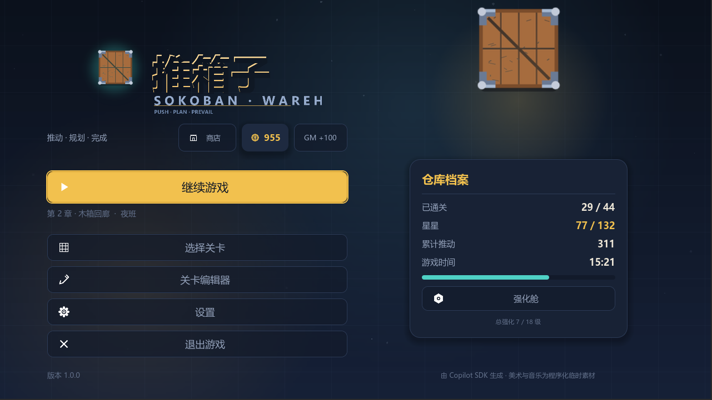
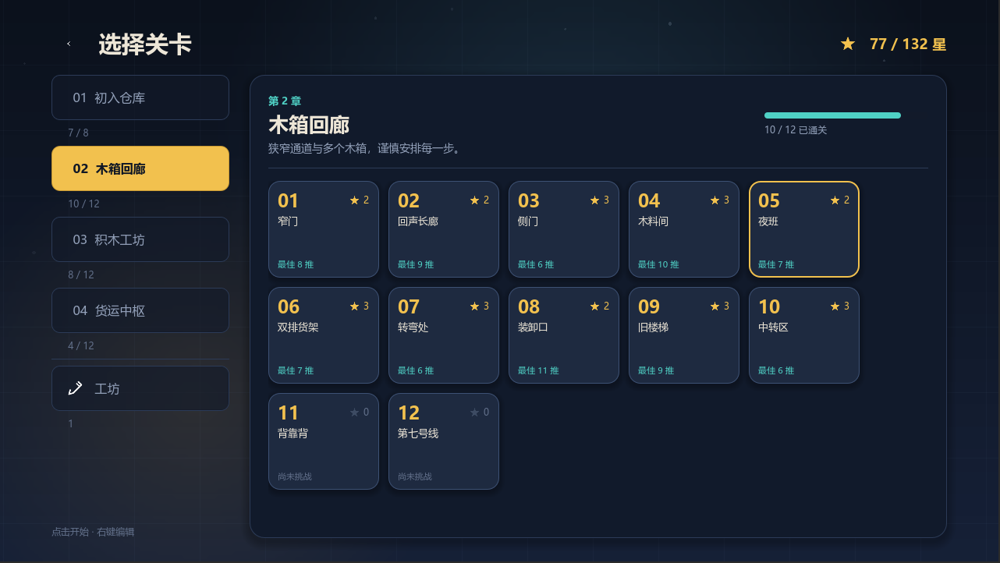
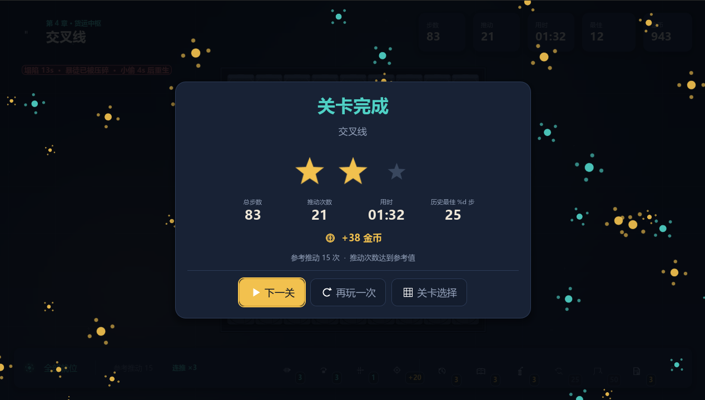
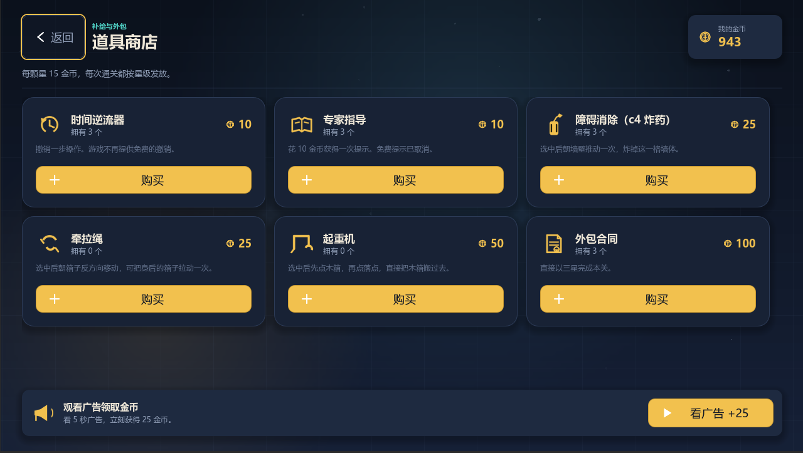
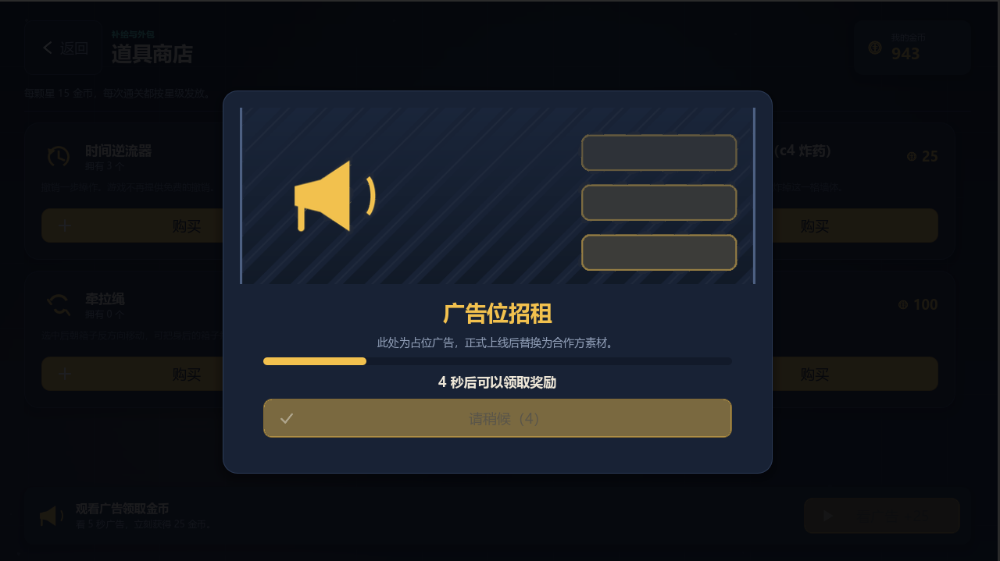
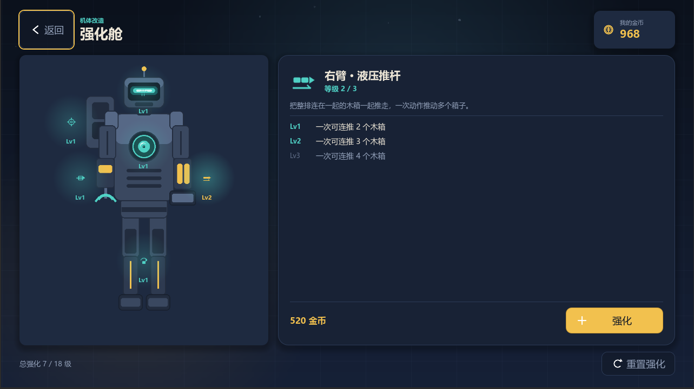
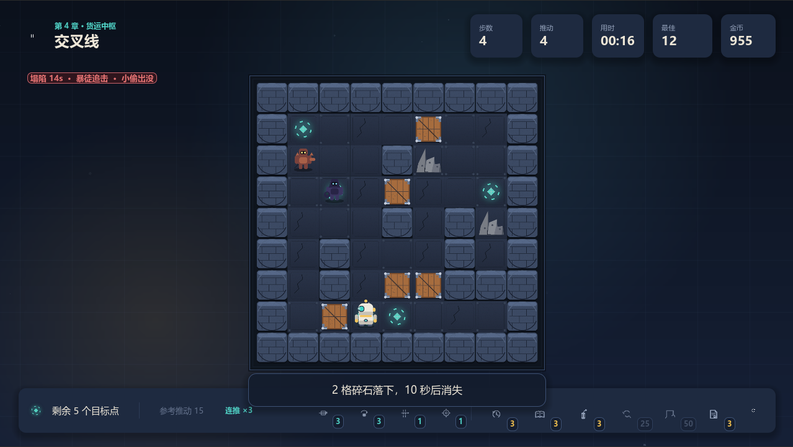
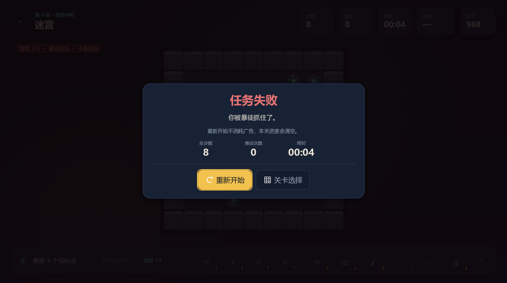
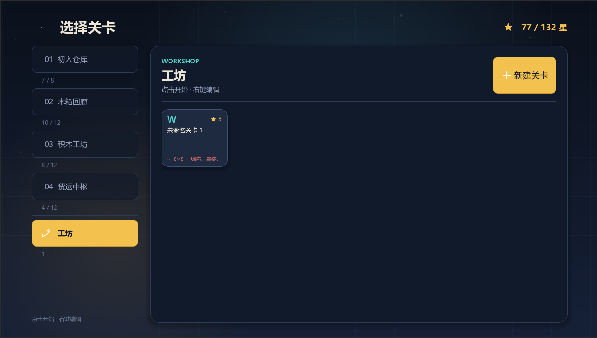
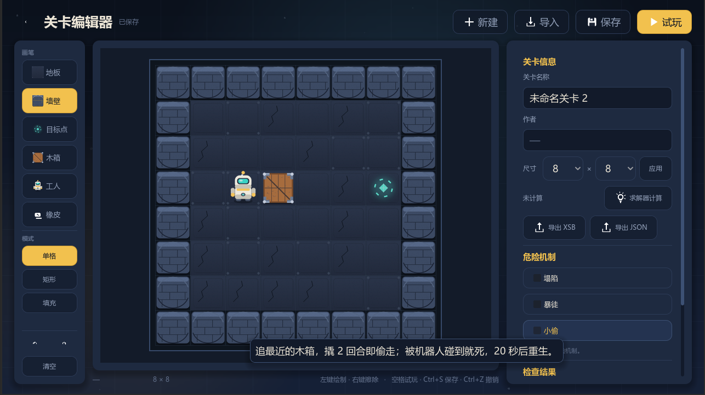

# 推箱子 · Sokoban（Godot 4.6）

一款使用 **Godot 4.6** 制作的完整推箱子游戏，包含 4 章 44 个内置关卡（全部默认解锁）、星级评分、金币道具商店（可看广告赚金币）、机器人强化系统，以及内置关卡编辑器（支持试玩、导入导出）。

> 美术与音频均为**程序化生成的临时素材**，可直接替换同名的 PNG / WAV 文件。



| 关卡选择（全部解锁） | 通关结算 |
| --- | --- |
|  |  |

| 道具商店 | 广告占位弹窗 |
| --- | --- |
|  |  |

| 强化舱 | 第四章危险机制 |
| --- | --- |
|  |  |

| 任务失败 | 工坊关卡（卡片带危险机制标签） |
| --- | --- |
|  |  |



---

## 快速开始

1. 安装 [Godot 4.6](https://godotengine.org/download)（标准版，无需 .NET）。
2. 在 Godot 项目管理器中「导入」本目录下的 `project.godot`。
3. 按 `F5` 运行（主场景为 `scenes/app.tscn`）。

命令行运行：

```powershell
& "路径\Godot_v4.6.3-stable_win64_console.exe" --path "C:\Users\huyiy\Desktop\推箱子"
```

导出发布版时，在「项目 → 导出」中添加 Windows / Linux / macOS 预设即可，无需额外资源挂载。

---

## 操作说明

| 操作 | 键位 |
| --- | --- |
| 移动 / 推箱 | `WASD`、方向键、手柄十字键、左摇杆；触屏滑动 |
| 使用道具 / 机体能力 | 点击底栏图标：左侧 4 个是机器人能力，右侧 6 个是金币道具 |
| 起重机选点 | 鼠标左键点木箱，再点落点 |
| 跃迁选点 | 鼠标左键点任意空地 |
| 取消选中 | `Esc` |
| 重来 | `R`、手柄 `LB`（需看 5 秒广告） |
| 暂停 / 返回 | `Esc`、手柄 `Start` |

规则为经典推箱子：只能推动，不能拉；箱子全部站上目标点即过关。
**游戏不再提供免费的撤销和提示**，这两项改成消耗道具。

---

## 关卡与进度

- **第 1 章 初入仓库**：8 个手工设计的教学关，逐条引入墙体、目标点、拐角推箱、箱堆、回退等概念。
- **第 2 章 木箱回廊**、**第 3 章 积木工坊**、**第 4 章 货运中枢**：各 12 关，由逆向求解器生成并逐关验证可解，难度按推动次数递增。
- 每关记录**最少推动次数**（par）。星级规则：推动次数 ≤ par 为 3 星，≤ ceil(par×1.3)+2 为 2 星，其余 1 星。
- 解锁：**全部章节与关卡默认解锁**，可以任意顺序游玩（`LevelCatalog.ALL_LEVELS_UNLOCKED`，关闭后恢复逐关解锁：通过上一关解锁下一关、完成上一章 75% 解锁下一章）。
- 主菜单「继续游戏」会回到最近游玩的关卡。
- 「自定义工坊」中可游玩自己在编辑器中保存的关卡。

关卡数据位于 `data/levels.json`，每条包含 `id / name_zh / name_en / tip_zh / tip_en / par_moves / par_pushes / rows`。

---

## 金币与道具

**金币收入**

- 通关时按**星级**结算：每颗星 15 金币（三星 45、两星 30、一星 15），**每次通关都会发放**，重复刷同一关同样计币。
- 只有战役关卡发币，编辑器试玩与自定义关卡不发币。
- 商店里可以**看 5 秒广告**（占位素材「广告位招租」）直接领取 25 金币。
- 金币由这些去处消耗：商店道具（10 / 25 / 50 / 100）、机器人强化（120 / 260 / 520 每级）、**机器人能力额外次数（每次 20）**。
- 主菜单右上角的 **`GM +100`** 是调试按钮：每点一次直接 +100 金币（正式发布前删掉该按钮即可，逻辑在 [main_menu.gd](scripts/screens/main_menu.gd) 的 `_grant_gm_coins`）。

**道具**（点击底部道具栏使用；库存为 0 时自动按标价购买，金币不足会提示）

| 道具 | 价格 | 效果 |
| --- | --- | --- |
| 时间逆流器 | 10 | 撤销一步操作（免费的撤销已被移除） |
| 专家指导 | 10 | 获得一次提示（免费提示已被移除），提示失败不扣道具 |
| 障碍消除（c4 炸药） | 25 | 选中后朝墙壁推一次，炸掉这一格墙体 |
| 牵拉绳 | 25 | 选中后背对木箱移动，把身后的箱子拉动一格 |
| 起重机 | 50 | 选中后点击木箱，再点击落点，直接把箱子搬过去 |
| 外包合同 | 100 | 直接以三星完成本关（结算标记「外包完成」） |

**广告**

- **重来**需要完整观看 5 秒广告（本关还没走过一步时免费）。
- 商店里的「看广告 +25」可随时领取金币奖励。
- 广告弹窗不可提前关闭，倒计时结束才能点击「领取奖励」。
- 广告素材为程序化生成的占位图 `assets/art/ad_banner.png`，接入真实广告 SDK 时替换该弹窗即可（[ui/ad_popup.gd](ui/ad_popup.gd) 暴露 `finish_now()` 供测试跳过倒计时）。

---

## 机器人强化

主菜单右侧「强化舱」进入强化界面：**右侧是机器人全身立绘，6 个部位都可以直接点击**，选中后右侧出现该部位的详情卡（等级、每级效果、价格、强化按钮），已升级部位在立绘上亮起青色能量光，`Lv3` 转金色。底部可以重置全部强化（返还 70%）。

强化不是发道具，而是**改写推箱子规则**：

| 部位 | 效果（Lv1 / Lv2 / Lv3） | 说明 |
| --- | --- | --- |
| 右臂 · 液压推杆 | 连推 2 / 3 / 4 个紧挨着的木箱 | 被动生效，一次动作推整排箱子 |
| 左臂 · 穿箱爪 | 每关 3 / 5 / ∞ 次穿箱 | 机械爪扣住箱体借力，直接穿过一整排木箱（不限个数） |
| 腿部 · 弹跳器 | 每关 3 / 6 / ∞ 次跨越 | 跨过身前的木箱落到它后面的空格 |
| 头部 · 相位目镜 | 每关 1 / 2 / 3 次穿墙 | 直接穿过一格墙体 |
| 背部 · 跃迁背包 | 每关 1 / 2 / 3 次跃迁 | 点击任意空地瞬移过去 |
| 胸口 · 过载核心 | 通关金币 +25% / +50% / +100% | 唯一经济型部位 |

- 价格：每级 120 / 260 / 520 金币（每部位 900）。
- **新手大礼包**：首次启动（或旧存档首次加载新版本）时，6 个部位全部直接送 **Lv1**，开局即可用满全部机械能力；已购买更高的等级不会被降低，礼包只补空缺，且终身只发一次（存档字段 `starter_gift`）。
- 能力次数**每关重置**，未强化的部位显示「未装」并禁用。
- **额外次数可花金币购买**：某次能力用完时，底栏按钮的角标会从数字变成 `+20`（金色），点一下即花 **20 金币**再买 1 次并直接进入待命状态；金币不足会提示且不扣钱、不扣次数。价格常量在 [robot_upgrades.gd](core/robot_upgrades.gd) 的 `EXTRA_CHARGE_PRICE`。
- 被动部位（推杆、核心）不给次数，直接在底栏显示「连推 ×N」并在结算时提高金币。
- 连推的每一箱仍然各计 1 次推动，所以星级（按推动次数）不会被强化破坏。
- 强化只在战役关卡生效，编辑器试玩与自定义关卡不注入能力。

---

## 关卡危险机制

机器人能破规则，关卡也有反制。危险按章节逐层解锁，**只在战役关卡生效**；**自定义关卡则由编辑器里的「危险机制」勾选决定**（试玩与正式游玩都会生效）：

| 章节 | 危险 | 规则 |
| --- | --- | --- |
| 第 2 章起 | 塌陷 | 每 **15 秒**落下 **1~2 格碎石**，碎石像墙一样挡住人与木箱，**10 秒后**自动消失 |
| 第 3 章起 | 暴徒 | 玩家每走 **2 步**，暴徒沿最短路径走 **1 步**追击（**会绕开木箱**）；被暴徒触碰到即任务失败。**把木箱推到暴徒身上会把它压碎**，暴徒从此消失、本关不再出现 |
| 第 4 章起 | 小偷 | 同样每 2 步走 1 步，目标是最**近的木箱**；贴到木箱后停留 **2 回合**撬箱，随后偷走木箱消失，任务失败。**机器人（玩家）碰到小偷即消灭小偷**，被撬的箱子安全。小偷**不会生成在木箱本身或木箱周围一圈的任意格**；**把木箱推到小偷身上不是压碎它，而是直接把箱子送上门**（小偷立刻带着箱子跑掉，任务失败）；被消灭的小偷会在 **20 秒后**重新出现（同样远离木箱） |

- 三个危险的应对方式各不相同：
  - **塌陷**：躲开即可，碎石 10 秒后自己消失。
  - **暴徒致命**：碰到就失败，唯一解法是把木箱推到它身上压碎它（它自己会绕开木箱，不会自杀）。
  - **小偷可被消灭**：碰到即死，但（1）它撬满 2 回合箱子就没了，（2）把箱子朝它推过去等于把箱子交给它，（3）杀掉它只买到 **20 秒**，之后还会来一个新的。
- **撬箱进度可以被打断**：小偷正在撬箱时，只要把那只木箱挪走（起重机搬运、牵拉绳拉动、c4 炸掉目标箱旁通道后挪箱、时间逆流器回退），它的撬箱进度立刻清零、徽标回到「小偷出没」，它得重新走到箱子旁从第 1 回合开始撬；挪箱本身不会导致失败。（用普通推箱把箱子从它脚下推走时，玩家会踩进小偷所在格，按接触规则当场消灭它。）
- 棋盘左上角的红色徽标实时显示塌陷倒计时与追兵状态（`塌陷 12s · 暴徒 · 小偷撬箱中`；解决掉的敌人显示 `暴徒已被压碎` / `小偷 18s 后重生`）。
- 碎石落下时有震屏与提示音；碎石与真实墙体会分别渲染（`assets/art/rubble.png`）。
- 被抓/被偷后进入「任务失败」结算：显示原因与步数，可**免费重新开始**（不消耗广告），进度清零。
- 危险计时只在关卡进行中推进（暂停、结算、广告弹窗时停止）。

---

## 关卡编辑器

从主菜单或选关页进入「关卡编辑器」。

- **画笔类型**：地板、墙、目标点、箱子、玩家、橡皮（选中玩家时画笔会移动已有玩家，保证场上只有一个玩家）。
- **画法**：单格、矩形（拖拽框选填充）、填充（区域填充连通的地板）。
- **尺寸调整**：侧栏调整宽高，缩小会截断超出范围的格子（有确认提示）。
- **检查 / 求解**：结构校验（尺寸、恰好一个玩家、箱子与目标数量匹配、玩家/箱子不在墙里、角落死锁、边界是否封闭等），并调用内置 A\* 求解器计算 par 与可解性。结构错误会阻止保存，警告类问题（如边界有缺口、箱子初始卡角）只提示。
- **试玩**：`Space` 或「试玩」按钮直接进入游戏，返回后工作区内容与撤销栈保持不变（试玩不写入进度与统计）。
- **危险机制开关**：侧栏「危险机制」可以单独勾选 **塌陷 / 暴徒 / 小偷**，只对这一关生效，试玩时立刻能验证；三者可任意组合，都不勾就是纯推箱子。开关会随关卡一起保存到自定义工坊，选关页的自定义卡片会以红色标出该关开启了哪些危险机制。
- **保存 / 导入 / 导出**：保存到自定义工坊；侧栏列出已保存关卡，可载入继续编辑或删除（删除有确认）；导入支持粘贴 XSB 文本或 JSON；导出把 XSB 或 JSON 复制到剪贴板（JSON 里带 `hazards` 字段）。

### 编辑器快捷键

| 操作 | 键位 |
| --- | --- |
| 保存 | `Ctrl+S` |
| 撤销 / 重做 | `Ctrl+Z` / `Ctrl+Y`（或 `Ctrl+Shift+Z`） |
| 试玩 | `Space` |
| 关闭弹窗 / 返回 | `Esc`（有未保存改动时会确认） |

### 支持的关卡文本格式

**XSB 格式**（默认导出）：

```
#######
#  .  #
# $@$ #
#  .  #
#######
```

- `#` 墙、` ` 地板、`.` 目标、`$` 箱子、`*` 箱子在目标、`@` 玩家、`+` 玩家在目标。
- 第一段非空行视为地图，后续空行结束解析。

**JSON 格式**：

```json
{
  "name_zh": "我的关卡",
  "name_en": "My Level",
  "rows": [
    "#######",
    "# @$ .#",
    "#######"
  ]
}
```

`rows` 也接受用换行分隔的单个字符串；`name` 可同时作为中英文名；可选字段 `tip_zh`、`tip_en`、`author`、`par_moves`、`par_pushes`。

---

## 设置

设置页与游戏内暂停菜单共用同一份设置：

- 主音量 / 音乐音量 / 音效音量
- 语言：简体中文 / English（即时切换界面文本）
- 全屏、屏幕震动、显示关卡提示

---

## 存档

- 位置：`%APPDATA%\SokobanFreightDepot\save.json`（即 `ProjectSettings.globalize_path("user://save.json")`）。
- 结构：设置、关卡进度（星级 / 最少推动）、统计数据、金币、道具库存、自定义关卡列表。
- 写入采用「临时文件 + 备份」策略：每次保存前把旧存档备份为 `save.backup.json`，主存档损坏时自动回退到备份。

---

## 目录结构

```
project.godot            工程配置（1280×720、canvas_items 拉伸、gl_compatibility）
scenes/app.tscn          主场景（根壳）
autoload/                全局单例：save_manager / loc / audio / game_manager
core/                    纯逻辑：level_data（解析/校验）、sokoban_state（规则/历史/道具与能力）、solver（A*）、level_catalog、items（金币与道具表）、robot_upgrades（强化表）
ui/                      UIKit（主题/控件工厂）、screen_base、background、settings_panel、ad_popup（5 秒广告弹窗）
scripts/app.gd           屏幕切换、淡入淡出、主题，以及所有开发测试模式
scripts/screens/         main_menu / level_select / game_screen / editor_screen / settings_screen / shop_screen / robot_screen
scripts/game/            board_view（棋盘渲染与动画）、hint_marker（提示标记）
scripts/editor/          editor_board（编辑器画板绘制与笔刷）
tests/self_test.gd       自检套件
tools/                   关卡生成器、美术/音频生成脚本
assets/art、assets/audio 临时美术与音频
data/levels.json         内置关卡
docs/screenshots/        文档截图（含 .gdignore，不参与导入与导出）
```

---

## 替换美术与音频

- 棋盘与角色：`assets/art/` 下同名 PNG，建议 128×128（`player_*_0/1` 为两帧动画，`floor_0/1/2` 为地板变体，`box`/`box_goal`/`goal`/`wall`）。
- 特效：`shadow.png`、`spark.png`、`dust.png`。
- 界面图标：`assets/art/icon_*.png`（64×64，白色单色，代码中用 `modulate` 上色），道具图标为 `icon_c4 / icon_rope / icon_crane / icon_rewind / icon_guide / icon_contract / icon_coin`，能力图标为 `icon_push / icon_pass / icon_jump / icon_phase / icon_warp / icon_core`。
- 机器人立绘：`robot_body.png`（440×860，正面全身）。强化界面的 6 个热区按比例锚定在立绘上，坐标在 [core/robot_upgrades.gd](core/robot_upgrades.gd) 的 `hotspot` 字段里，替换立绘时同步调整即可。
- 广告占位图：`ad_banner.png`（640×300）。
- 标志：`logo.png`。
- 音频：`assets/audio/*.wav`。音乐 `music_menu.wav` / `music_game.wav` 需为可循环素材（运行时自动设置循环点）。
- 替换后若 Godot 未刷新，执行「项目 → 重新导入」。

如想重新生成临时素材：

```powershell
python tools\gen_art.py
python tools\gen_audio.py
python tools\sokoban_gen.py verify   # 校验 data/levels.json 全部关卡可解且 par 正确
```

---

## 开发与测试

所有开发模式通过 `--` 之后的参数传给游戏：

```powershell
$godot = "D:\downloads\Godot_v4.6.3-stable_win64.exe\Godot_v4.6.3-stable_win64_console.exe"
$proj  = "C:\Users\huyiy\Desktop\推箱子"

# 刷新全局类缓存（新增 class_name 后必须执行一次）
& $godot --headless --path $proj --editor --quit

& $godot --headless --path $proj -- --selftest   # 逻辑自检：关卡/解锁/状态机/求解器/本地化/音频/金币与道具/机器人强化与能力/危险机制
& $godot --headless --path $proj -- --flowtest   # 界面流程：编辑器→试玩→键盘操作→道具→商店→广告→重来闸门→强化舱点部位升级→关卡内使用能力→危险机制与压碎暴徒→连推
& $godot --headless --path $proj -- --savetest   # 存档：进度/金币/道具/强化/新手礼包迁移/自定义关卡/备份恢复
& $godot --headless --path $proj -- --dumpui     # 输出各屏幕控件实际矩形，检查越界

# 截图（需窗口模式，输出到 user://dev_shots，即 %APPDATA%\SokobanFreightDepot\dev_shots）
& $godot --path $proj --windowed --resolution 1280x720 --position 80,60 -- --capture
```

自检会逐关调用内置 A\* 求解器验证最优解路径可执行且与 par 一致，整套约需 1 分钟。
开发模式均不会写入玩家存档（截图/流程测试通过 `SaveManager.capture_mode` 禁止落盘），截图也刻意输出到 `user://`，不会被打包进发布版本。
`--headless` 下音频驱动为 dummy，`Audio` 会自动跳过播放，因此无头测试日志保持干净。

---

## 已知限制

- 内置提示求解器适用于 ≤127 格、≤7 个箱子的关卡；超出范围的超大自定义关卡可正常游玩，但「专家指导」与编辑器的「检查求解」会提示不支持。
- 道具与机器人能力只在战役关卡可用；编辑器试玩与自定义关卡里按钮为禁用状态（同时不产生金币）。
- 广告为本地占位弹窗（5 秒倒计时），没有接入真实广告 SDK；接入时替换 [ui/ad_popup.gd](ui/ad_popup.gd) 即可。
- 强化会让部分关卡变得更容易（例如连推 / 穿墙 / 跃迁），`par` 与星级仍按原规则计算；连推按每箱各计一次推动，因此三星标准不会被强化放宽。
- 设置页切换语言后，已经打开的暂停菜单与 HUD 文本会在下次进入界面时更新。
